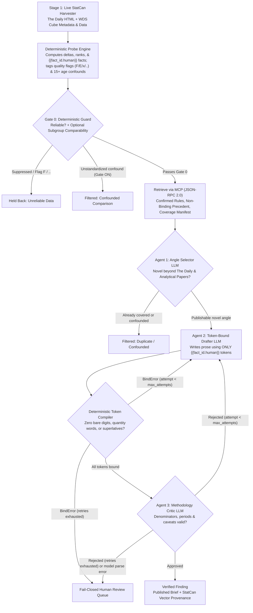

# Remine (v0.2.0)

**Token-bound agentic re-mining of Statistics Canada *The Daily* releases and Web Data Service (WDS) data cubes.**

Remine pairs deterministic statistical probes and fail-closed symbolic token binding with a 7-node LangGraph workflow and an audited JSON-RPC 2.0 Model Context Protocol (MCP) server to uncover under-reported comparisons while eliminating numerical hallucination, confounded denominators, and duplicate reporting.

---

## Architecture & Logic Flow



---

## Module Layout

All runtime modules live under [`src/remine/`](src/remine/):

- `models.py` — Typed domain contracts (`Fact`, `CandidateBrief`, `MethodRule`, `TokenBinding`, `TraceEvent`), Gate 0 semantic comparability checks, and zero-numeral `{{fact_id.human}}` symbolic token compiler (`bind_story`).
- `tools.py` — Read-only snapshot repository, confirmed-only methodology rule filtering (`confirmed=True`), non-binding editorial precedent recall, and Two-Tier `CoverageManifest` overlap detection (`check_coverage_overlaps`).
- `probes.py` — Deterministic Pandas statistical probe suite (`gap_between_members`, `gap_trend`, `long_run_compare`, `period_change`, `share_of_total`, `rank_order`), `F`/`E`/`x`/`..` suppression filtering, mention extraction, and standard-error gating.
- `harvester.py` — Live Statistics Canada *The Daily* HTML & WDS REST API harvester (`discover_daily_articles`, `fetch_cube_metadata`, `harvest_daily_release`).
- `mcp_server.py` — Zero-dependency JSON-RPC 2.0 MCP server (`RemineMCPServer` + audited `MCPToolClient`) exposing 6 read/harvest tools over `stdio` or in-process dispatch.
- `agents.py` — Role-specialized agents (`ANGLE_SYSTEM`, `DRAFTER_SYSTEM`, `CRITIC_SYSTEM`), strict `json_schema` decoding, `<think>` / `reasoning_content` fallback, `URGENT_REVISION_REQUIRED` retry feedback, and `LLMCallRecord` telemetry.
- `workflow.py` — 7-node LangGraph `StateGraph` (`START -> gate -> retrieve -> angle -> draft -> bind_check -> critic -> review -> END`) using `Command[Literal[...]]` routing, `RetryPolicy` for transient errors, fail-closed `_is_model_failure` escalation, and `Annotated[..., operator.add]` reducers.
- `evaluation.py` — Verdict & skip-category accuracy metrics, Gate 0 ablation comparison, and full JSON run serialization.
- `web.py` + [`web/`](src/remine/web/) — Zero-dependency `ThreadingHTTPServer` interactive explorer (`index.html`, `styles.css`, `app.js`) designed in plain language for policy and social science staff, with automatic static-archive fallback for GitHub Pages.
- `cli.py` — Unified CLI entrypoint (`run`, `harvest`, `serve`, `mcp`).

**Live Web Explorer (GitHub Pages):** <https://p3ji.github.io/remine/> (built from `docs/` via `python scripts/build_pages.py`).

---

## Quickstart

Requires **Python 3.11+** with `langgraph`, `openai`, `pandas`, `pyyaml`, and `requests`.

```sh
# Create or reuse a Python 3.11+ environment and install dependencies:
pip install -e .
# Or run directly without editable install using PYTHONPATH=src
```

### Run CLI & Web Workbench

```sh
# 1. Run deterministic replay + Gate 0 semantic comparability check
PYTHONPATH=src python -m remine.cli run --mode replay --semantic-gate

# 2. Launch the interactive Web Workbench (http://127.0.0.1:8765)
PYTHONPATH=src python -m remine.cli serve --port 8765

# 3. Harvest a live Statistics Canada Daily release + WDS cube slice
PYTHONPATH=src python -m remine.cli harvest

# 4. Run against a local OpenAI-compatible /v1 server (e.g., LM Studio / Splash)
PYTHONPATH=src python -m remine.cli run --mode live --model qwen3.8-27b --base-url http://127.0.0.1:1234/v1 --semantic-gate

# 5. Start the JSON-RPC 2.0 MCP server over stdio
PYTHONPATH=src python -m remine.cli mcp
```

### Verify Automated Tests

```sh
python -m unittest discover -s tests -v
```

### Reproduce Multi-Model Benchmarks

```sh
python scripts/run_benchmarks.py
```

Outputs are written to `data/benchmark_results.json`.
